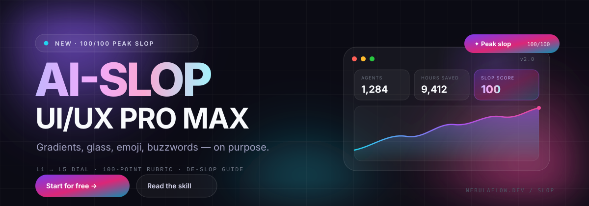

# AI-SLOP UI/UX PRO MAX ✨



> An agent skill that deliberately generates the cliché **"AI-generated" UI/UX** — violet-to-cyan
> gradients, glassmorphism, floating orbs, emoji icon chips, bento grids, fake logo walls, glowing
> "Most Popular" pricing, and SaaS buzzword copy — **on purpose, at maximum volume, at production
> quality.**

The aesthetic is the point. The engineering is not a joke: responsive to 360px, keyboard usable,
`prefers-reduced-motion` safe, zero dependencies, real copy, and a 100-point scoring rubric.

```text
TOTAL   100/100   Peak slop
```

---

## Why does this exist?

Because a whole genre of interface has emerged — and it is now possible to name it precisely:
`#0B0B14` canvas, three blurred orbs, a gradient headline, a glass nav, an announcement pill, a
bento grid of emoji, a fake logo marquee, three pricing tiers with a glowing middle card, and copy
that says **"supercharge your workflow"**.

This repo turns that genre into a **design system** you can invoke, dial from tasteful to
radioactive, score, and — most importantly — **de-slop** when you want to make something that looks
human again.

- 🎛️ **Slop Dial L1–L5** — from "calm Modern SaaS" to "peak slop", switchable at runtime.
- 🧩 **The Slop Dozen** — 12 non-negotiable signals that make a page unmistakably AI-made.
- 📊 **Slop Score** — a 100-point rubric + a zero-dependency CLI to grade any HTML file.
- 🎨 **Drop-in stack** — tokens, components, motion: `assets/slop-tokens.css`, `assets/slop.css`,
  `assets/slop.js`.
- 🚀 **Reference implementation** — `demo/index.html` (NebulaFlow AI) scores **100/100**.
- 🧼 **The redemption arc** — `references/08-de-slop.md` turns slop into a genuinely good interface.

---

## Quickstart

```bash
# 1. See peak slop
npm run demo            # → http://localhost:4173/demo/

# 2. Grade it (or any page)
npm run score           # 100/100 — Peak slop
node tools/slop-score.mjs path/to/page.html --json

# 3. Run the tests
npm test
```

No install step, no dependencies. Node 18+ for the tools; the demo is plain HTML/CSS/JS.

---

## Use it as an agent skill

### Claude (Code / claude.ai skills)

Drop the repo (or a zip of it) into your skills directory:

```bash
# Claude Code, personal skills
mkdir -p ~/.claude/skills/ai-slop-ui-ux-pro-max
cp -r SKILL.md references assets ~/.claude/skills/ai-slop-ui-ux-pro-max/
```

Then ask: **"Use ai-slop-ui-ux-pro-max at L5. Build a landing page for a fictional AI notebook."**

`SKILL.md` uses progressive disclosure: the core contract is short, and the ten `references/` files
are loaded only when needed.

### Cursor / Windsurf / Cline

Add a rule that points at `SKILL.md` — see [`AGENTS.md`](AGENTS.md) for copy-paste snippets.

### ChatGPT / Codex / any chat

Paste the **Master prompt** from [`references/09-prompt-library.md`](references/09-prompt-library.md)
together with `SKILL.md`. The condensed one-paragraph contract lives in `AGENTS.md`.

### GitHub Copilot

Add `AGENTS.md` instructions to `.github/copilot-instructions.md`, or simply reference `SKILL.md`
in your prompt.

---

## The Slop Dial

Set `data-slop="1…5"` on `<html>` or `<body>`. The tokens react automatically (orb opacity, glow,
motion scale, chroma, emoji visibility). The demo includes a live switcher in the bottom-right corner.

| Level | Vibe | Signals |
| ----- | ---- | ------- |
| **L1** | Tasteful modern | one accent, solid surfaces, no emoji, 56px hero |
| **L2** | Seed round | gradient phrase, 2 faint orbs, glass nav, 3-card bento |
| **L3** | Series A | full hero, marquee, stats, 6 features, testimonials, pricing, FAQ |
| **L4** | Stealth AI, $40M raised | grain, grid, drift, counters, cursor glow, emoji chips |
| **L5** | **Peak slop** (default) | everything at once, shimmer, glowing pricing, sparkles |

Details: [`references/00-slop-levels.md`](references/00-slop-levels.md).

---

## The Slop Dozen

Every deliverable must contain all twelve:

1. Gradient headline (violet → pink → cyan, `background-clip: text`)
2. Glass panel with `backdrop-filter: blur(20px)` and a 1px white/10 border
3. Blurred orbs / mesh + film grain
4. Announcement pill with emoji + "NEW" + →
5. Dual CTA: glowing gradient primary + ghost secondary
6. Social proof cluster: avatars, ★★★★★, "12,000+ teams", "No credit card"
7. Bento grid with emoji icon chips and 24px radii
8. Fake logo marquee with edge fade
9. Three pricing tiers, glowing "✨ Most popular"
10. Buzzword copy, zero lorem ipsum
11. Scroll reveals + marquee + hover glow + ambient motion
12. Near-black ink, 24–40px radii, 96–128px section rhythm

---

## The Slop Score

`tools/slop-score.mjs` reads a local HTML file, follows its local CSS/JS, and checks ten categories:

```
Gradient chroma · Glass & depth · Atmosphere · Typography · Layout & structure
Components · Copy · Social proof · Motion · Craft & ethics
```

Bands: **95+ Peak slop** · 90–94 Certified slop · 80–89 Slop-adjacent · 65–79 Diet slop ·
40–64 Corporate minimalism · <40 De-slopped.

```bash
node tools/slop-score.mjs demo/index.html            # pretty report
node tools/slop-score.mjs demo/index.html --json     # machine-readable
node tools/slop-score.mjs demo/index.html --fail-under 90   # CI gate
```

The rubric in full: [`references/07-slop-score.md`](references/07-slop-score.md).

---

## Repository map

```
SKILL.md                    ← the skill (YAML frontmatter + operating contract)
AGENTS.md                   ← wiring for Codex / Cursor / Cline / any agent
references/
  00-slop-levels.md         ← L1–L5 dial, anti-franken-slop rules
  01-visual-language.md     ← gradients, glass, glow, orbs, texture
  02-color-and-type.md      ← palettes, type scale, Tailwind mapping
  03-layout-recipes.md      ← landing / dashboard / pricing / auth / deck / email
  04-components.md          ← copy-paste HTML for every component
  05-copywriting.md         ← lexicon, formulas, emoji map, RU/EN bank
  06-motion-and-texture.md  ← reveals, marquee, counters, performance
  07-slop-score.md          ← 100-point rubric and grading bands
  08-de-slop.md             ← how to make it tasteful again
  09-prompt-library.md      ← ready-to-run prompts
assets/
  slop-tokens.css           ← design tokens (L1–L5 scaling)
  slop.css                  ← drop-in component stylesheet
  slop.js                   ← behavior: reveal, marquee, counters, dial, toast
  img/orb.webp, img/mesh.webp ← AI-generated atmosphere assets
demo/index.html             ← NebulaFlow AI, the reference implementation
tools/
  slop-score.mjs            ← the linter / scorer
  slop-score.test.mjs       ← tests (node --test)
  serve.mjs                 ← zero-dependency preview server
```

---

## Design tokens

```html
<html data-slop="5" data-theme="dark">
  <head>
    <link rel="stylesheet" href="assets/slop-tokens.css" />
    <link rel="stylesheet" href="assets/slop.css" />
  </head>
  <body class="slop">
    <!-- your incredibly gradient-heavy page -->
    <script src="assets/slop.js"></script>
  </body>
</html>
```

Core palette: `#0B0B14` ink · `#8B5CF6` violet · `#EC4899` pink · `#22D3EE` cyan.
Light theme available via `data-theme="light"`. Tailwind config: `references/02-color-and-type.md`.

---

## The redemption arc

Slop is a critique as much as a style. When the joke has served its purpose, run
[`references/08-de-slop.md`](references/08-de-slop.md):

- replace effects with hierarchy,
- replace adjectives with numbers,
- keep one accent, one strong focal point, one honest proof point,
- restore contrast, focus rings, and reduced motion.

The ideal de-slop scores **below 60** — and feels like a person made a decision.

---

## Notes

- All brands, people, testimonials, and metrics in the demo are **fictional**.
- The orb and mesh images were AI-generated for this pack.
- No tracking, no external runtime dependencies. Google Fonts is referenced by the demo only and
  degrades to system fonts offline.
- License: [MIT](LICENSE).

---

<p align="center"><strong>Made with ✨ and an irresponsible number of gradients.</strong></p>
