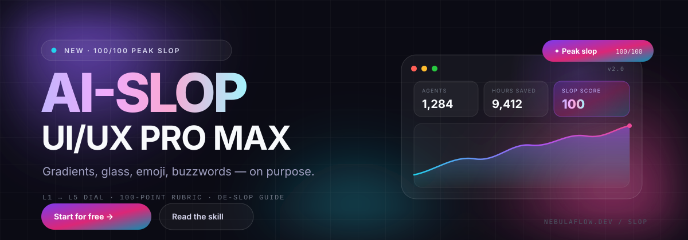

# AI-SLOP UI/UX PRO MAX ✨



> Скилл для ИИ-агентов, который **намеренно** генерирует тот самый «дизайн от нейросети»:
> фиолетово-циановые градиенты, глассморфизм, парящие орбы, эмодзи-иконки, bento-сетки,
> фейковые логотипы, светящуюся карточку «Most popular» и копирайтинг из мира SaaS-бзделла —
> **осознанно, на максимум, но с продакшн-качеством.**

Эстетика — это шутка. Инженерия — нет: адаптив от 360px, доступность с клавиатуры,
`prefers-reduced-motion`, ноль зависимостей, живой текст и оценка по 100-балльной шкале.

```text
TOTAL   100/100   Peak slop
```

---

## Быстрый старт

```bash
npm run demo     # демо NebulaFlow AI → http://localhost:4173/demo/
npm run score    # оценка страницы: 100/100 — Peak slop
npm test         # тесты скорера
```

Нужен только Node 18+ для инструментов. Само демо — чистый HTML/CSS/JS.

---

## Как подключить как скилл

**Claude Code:**
```bash
mkdir -p ~/.claude/skills/ai-slop-ui-ux-pro-max
cp -r SKILL.md references assets ~/.claude/skills/ai-slop-ui-ux-pro-max/
```

**Cursor / Windsurf / Cline / Codex** — см. [`AGENTS.md`](AGENTS.md).
**Любой чат** — вставьте «Master prompt» из
[`references/09-prompt-library.md`](references/09-prompt-library.md) вместе с `SKILL.md`.

Дальше просто попросите:

> Use ai-slop-ui-ux-pro-max at L5. Сделай лендинг для вымышленного AI-сервиса.

---

## Что внутри

| Файл | Зачем |
| ---- | ----- |
| `SKILL.md` | контракт скилла: правила, воркфлоу, чек-лист, формат выдачи |
| `references/00–09` | уровни, визуальный язык, цвет/типографика, макеты, компоненты, копирайтинг, моушн, рубрика, de-slop, промпты |
| `assets/slop-tokens.css` | токены, включая шкалу L1–L5 |
| `assets/slop.css` | готовые стили компонентов (drop-in) |
| `assets/slop.js` | reveal, marquee, счётчики, переключатель уровня, тост |
| `demo/index.html` | эталон: NebulaFlow AI, 100/100 |
| `tools/slop-score.mjs` | линтер/скоринг: `node tools/slop-score.mjs file.html` |

---

## Шкала слопа

`data-slop="1…5"` на `<html>` или `<body>` — токены подстраиваются сами.

| Уровень | Вайб |
| ------- | ---- |
| **L1** | Аккуратный современный сайт: один акцент, без эмодзи |
| **L2** | Раунд сида: градиентный заголовок, лёгкие орбы, 3 карточки |
| **L3** | Классический Series A лендинг: всё по канону |
| **L4** | Stealth AI со $40M: зерно, сетка, счётчики, cursor glow |
| **L5** | **Максимальный слоп** (по умолчанию): всё и сразу |

---

## Оценка

```
Gradient chroma · Glass & depth · Atmosphere · Typography · Layout & structure
Components · Copy · Social proof · Motion · Craft & ethics
```

**95+** — пик слопа · **90–94** — можно шипить · **80–89** — недостаточно commitment ·
**65–79** — диетический слоп · **<40** — вы всё отмыли (подозрительно).

```bash
node tools/slop-score.mjs demo/index.html
node tools/slop-score.mjs demo/index.html --json
node tools/slop-score.mjs demo/index.html --fail-under 90
```

---

## Обратный путь

Слоп — это ещё и критика жанра. Когда шутка сделала своё дело, откройте
[`references/08-de-slop.md`](references/08-de-slop.md): убрать эффекты, оставить иерархию,
заменить прилагательные цифрами, вернуть контраст и фокус. Идеальный de-slop набирает
**меньше 60** — и выглядит так, будто его делал человек.

---

## Дисклеймер

Все бренды, люди, отзывы и метрики в демо **вымышлены**. Никаких реальных логотипов и
торговых марок. Orb и mesh-фон сгенерированы ИИ специально для этого пака. Лицензия —
[MIT](LICENSE).

---

<p align="center"><strong>Сделано с ✨ и безответственным количеством градиентов.</strong></p>
